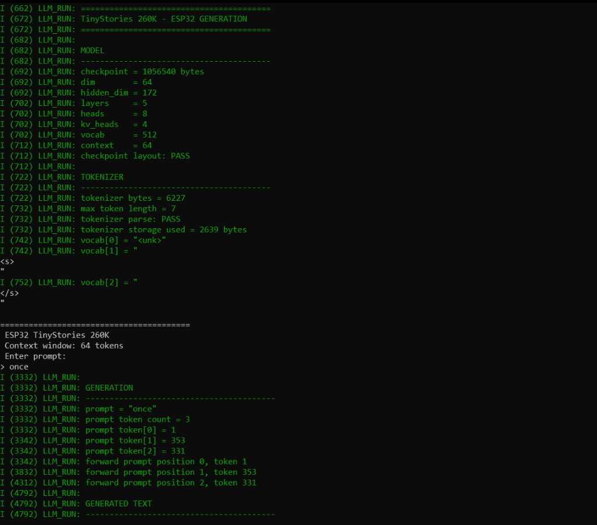
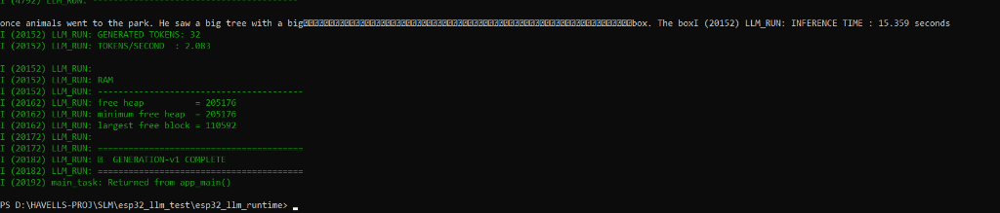
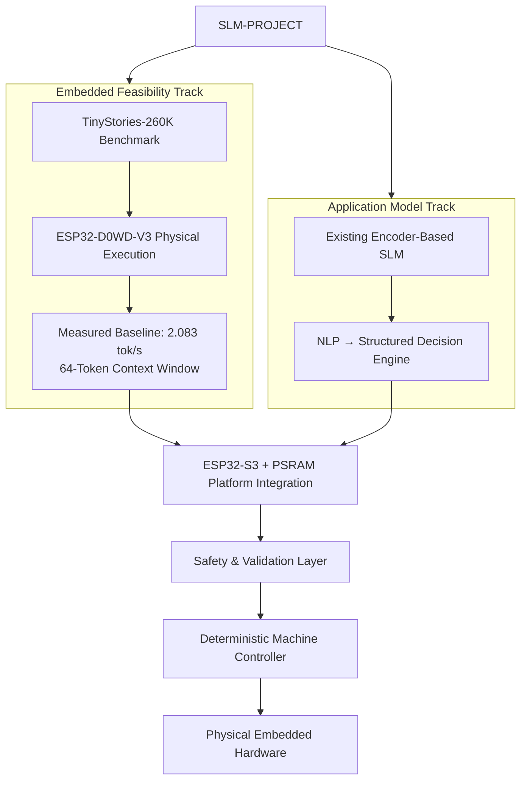
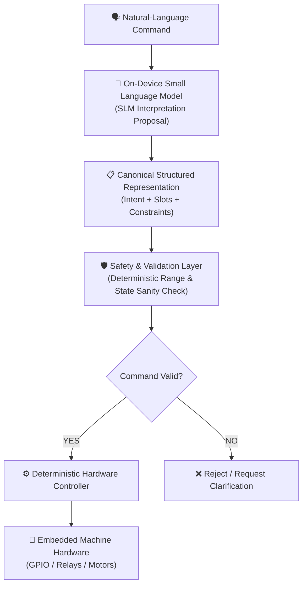

# SLM-PROJECT

<p align="center">
  <b>On-Device Small Language Model (SLM) Inference & Structured Decision-Making on Resource-Constrained Embedded Microcontrollers</b>
</p>

<p align="center">
  
  
  
  
  
</p>

---

## 🎯 Executive Overview

**SLM-PROJECT** is an experimental embedded AI research project investigating how Small Language Models (SLMs) can enable **natural-language understanding and structured decision-making on resource-constrained microcontrollers**.

The central research problem is to determine how much language understanding and structured decision capability can be performed locally under severe embedded constraints in memory, compute, storage, and power—without relying on cloud APIs or external coprocessors.

```text
Natural-Language Command
        ↓
Small Language Model
        ↓
Canonical Structured Representation
        ↓
Safety & Validation Layer
        ↓
Deterministic Controller
        ↓
Embedded Machine Hardware
```

### 💡 Core Research Question

> **Can a sufficiently small language model perform reliable natural-language → structured-decision inference locally on a resource-constrained microcontroller, while remaining within practical embedded memory, compute, storage, and latency constraints?**

---

## 🏆 Current Feasibility Baseline

We have successfully established the **Embedded Feasibility Substrate** on physical hardware:

* **Physical Target:** ESP32-D0WD-V3 (Xtensa LX6 dual-core @ 160 MHz, 4 MB SPI Flash, zero external PSRAM).
* **Model Executed:** **TinyStories 260K** (~260K parameters, 5-layer LLaMA architecture, 1.056 MB FP32 binary checkpoint).
* **Measured Baseline Throughput:** **2.083 tokens/second** generation throughput with a **64-token runtime context window** and **32 generated tokens**.
* **Generation Output:** Prompt `"once"` → `"once animals went to the park. He saw a big tree with a big box. The box"`.
* **Stability:** Fully stable under FreeRTOS without triggering task watchdog timeouts.

### 📸 Physical ESP32 Hardware Serial Logs

| 1. Checkpoint Parsing & Tokenizer Init | 2. Autoregressive Text Generation & Throughput |
| :---: | :---: |
|  |  |

> [!NOTE]
> **TinyStories 260K is an experimental feasibility benchmark, not the final application model.**
> It validates that genuine neural language-model execution, BPE tokenization, Flash weight addressing, and static KV-cache management can operate reliably under raw ESP32 microcontroller constraints.

---

## 🏗️ Architectural Strategy: Dual-Track Approach

The project decouples **embedded substrate validation** from **application-oriented model research**.



### 1. Application Architecture & Safety Isolation
The intended application architecture does not require free-form text generation. It primarily requires **language understanding followed by structured prediction**.

For example, in the primary demonstration domain of **smart washing machine control**:
> *"Start a quick cotton wash at 40 degrees with 800 RPM spin"*

is converted into a **Canonical Structured Representation**:

```json
{
  "action": "START",
  "program": "COTTON",
  "temperature": 40,
  "spin_speed": 800,
  "options": ["QUICK"]
}
```



> **Safety Constraint:** The language model never directly actuates hardware. Its output is strictly an interpretation proposal validated by a deterministic safety layer.

---

## 💻 Hardware & Memory Specifications

| Parameter | Specification | Note |
| :--- | :--- | :--- |
| **MCU Target** | ESP32-D0WD-V3 (Revision 3.1) | Dual-Core Xtensa LX6 @ 160 MHz |
| **Flash Memory** | 4 MB SPI Flash (DIO Mode @ 40 MHz) | Partitioned to 1.5 MB Factory App |
| **SRAM** | 520 KB Internal SRAM | **No external PSRAM used** |
| **Free Heap Baseline** | ~304 KB free heap | Max contiguous block: ~172 KB |
| **Framework** | ESP-IDF v5.5.5 | Toolchain: GCC / G++ 14.2.0 |
| **Model Storage** | Embedded C++ Byte Array | Direct Flash reading (`0x3f40738c`) |

---

## 📂 Repository Structure

```text
SLM-PROJECT/
├── README.md                                          ← Project home & repository overview (this file)
├── context.md                                         ← Comprehensive technical context & architectural blueprint
├── progress.md                                        ← Complete historical log, phase details & deep-dive reports
├── eim_config.toml                                    ← Espressif Installation Manager configuration
│
├── docs/                                              ← Technical documentation & presentation PDFs
│   ├── SLM.pdf
│   └── SLM - 2.pdf
│
├── esp32_llm_test/                                    ← Primary SLM runtime development stack
│   ├── model/
│   │   ├── stories260K.bin                            ← 1,056,540-byte TinyStories binary checkpoint
│   │   └── tok512.bin                                 ← 6,227-byte BPE tokenizer binary
│   │
│   ├── reference/                                     ← PC Golden Reference engine (Karpathy llama2.c port)
│   │   ├── run.c                                      ← C reference inference runner
│   │   ├── win.c / win.h                              ← Windows MSVC compatibility layer
│   │   └── build_msvc.bat                             ← MSVC build script
│   │
│   └── esp32_llm_runtime/                             ← ESP32 C++ ESP-IDF project
│       ├── CMakeLists.txt
│       ├── sdkconfig
│       ├── generate_model.py                          ← Binary to C++ header array converter
│       └── main/
│           ├── esp32_llm_runtime.cpp                  ← Complete 5-layer Transformer runtime (3,150+ lines)
│           └── model/
│               ├── stories260K_model.cc / .h          ← Embedded model array in Flash
│               └── tok512_model.cc / .h               ← Embedded BPE tokenizer array
│
├── esp32_tflite_test/                                 ← Phase 1 TinyML baseline project (TFLite Micro)
│   └── main/esp32_tflite_test.cpp                     ← INT8 Sine wave TFLite Micro smoke test
│
├── data_v5_leakage_controlled/                        ← Synthetic dataset pipeline for domain SLM benchmark
│   ├── generate_washing_machine_dataset_v5_leakage_controlled.py
│   ├── washing_machine_synthetic_v5_train_24000.jsonl ← 24,000 training samples
│   ├── washing_machine_synthetic_v5_validation_3000.jsonl
│   └── washing_machine_synthetic_v5_test_3000.jsonl
│
└── metadata/                                          ← Washing machine dataset schemas & statistics
    ├── washing_machine_synthetic_v5_metadata.csv
    └── washing_machine_v5_data_dictionary.csv
```

---

## ⚡ Quick Start & Reproduction

### Prerequisites
* **ESP-IDF v5.5.5** (installed via Espressif Installation Manager)
* **Python 3.10+** (with active ESP-IDF virtual environment)
* **Windows MSVC Build Tools 2022** (for PC golden reference validation)

### 1. Run PC Golden Reference

Validate model correctness on desktop before flashing:

```cmd
cd esp32_llm_test\reference
call "C:\Program Files (x86)\Microsoft Visual Studio\2022\BuildTools\VC\Auxiliary\Build\vcvars64.bat"
cl.exe /fp:fast /O2 /openmp /I. run.c win.c
run.exe ..\model\stories260K.bin -z ..\model\tok512.bin -t 0.0 -n 50
```

### 2. Build & Flash ESP32 Substrate Benchmark (`esp32_llm_runtime`)

Flash and monitor the physical ESP32 device:

```bash
cd esp32_llm_test/esp32_llm_runtime
idf.py set-target esp32
idf.py build
idf.py -p COM6 --flash_size 4MB flash monitor
```

*(Press `Ctrl + ]` to exit the serial monitor).*


## 📖 Key Documentation Links

* [`context.md`](file:///d:/HAVELLS-PROJ/SLM/context.md) — Comprehensive technical architecture, mathematical formulations, dual-track strategy, and memory blueprint.
* [`progress.md`](file:///d:/HAVELLS-PROJ/SLM/progress.md) — Complete historical engineering log, phase-by-phase test outputs, and diagnostic notes.

---

## 📜 License & Disclaimers

This project is an experimental engineering benchmark. The **TinyStories 260K** model is used strictly as an inference substrate feasibility test and is not intended for end-user text generation.
