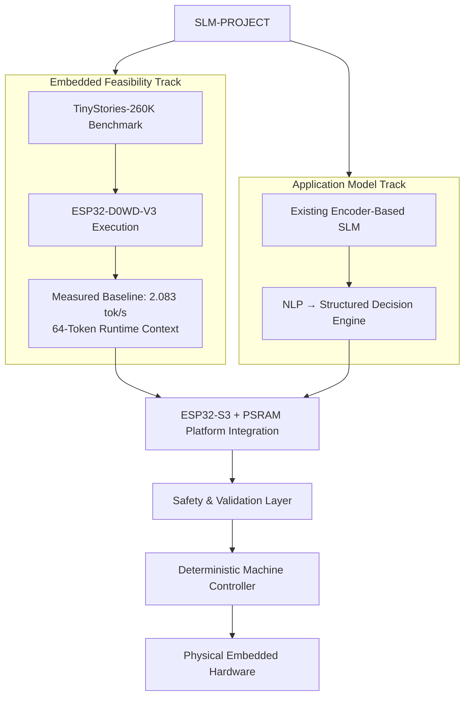
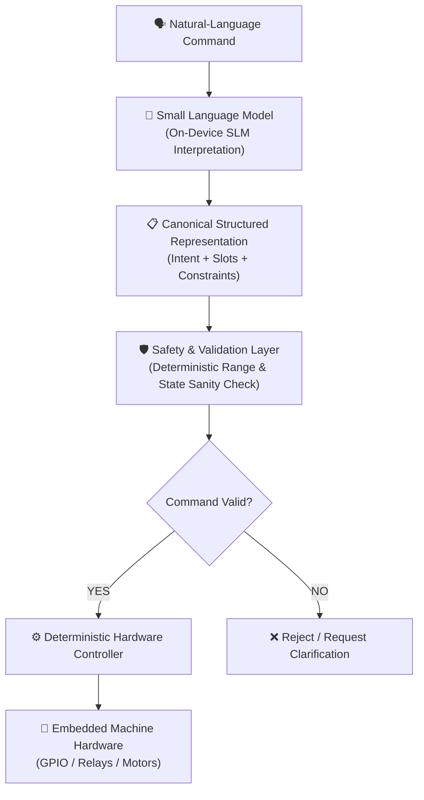
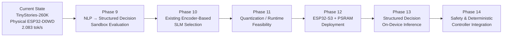

# SLM-PROJECT — Context & Architecture Blueprint

### Small Language Model (SLM) Inference on Resource-Constrained Embedded Microcontrollers

> **Embedded Feasibility Milestone Achieved:** End-to-end autoregressive inference and text generation of **TinyStories 260K** running locally on a physical **ESP32-D0WD-V3**.
>
> **Measured Hardware Baseline:** **2.083 tokens/second** generation throughput with a **64-token runtime context** and **32 generated tokens** on the physical ESP32-D0WD-V3.

---

## 1. Project Overview & Research Objectives

**SLM-PROJECT** is an experimental embedded AI research project investigating how Small Language Models (SLMs) can enable **natural-language understanding and structured decision-making on resource-constrained microcontrollers**.

The project investigates the complete path from:

```text
Natural-Language Command
        ↓
Small Language Model
        ↓
Structured Machine Representation
        ↓
Safety & Validation
        ↓
Deterministic Controller
        ↓
Embedded Hardware
```

The central research problem is to determine how much language understanding and structured decision capability can be performed locally under severe embedded constraints in memory, compute, storage, and power.

### Core Research Question

> **Can a sufficiently small language model perform reliable natural-language → structured-decision inference locally on a resource-constrained microcontroller, while remaining within practical embedded memory, compute, storage, and latency constraints?**

### Experimental Strategy & Dual-Track Approach

The project uses a staged hardware-validation approach divided into two tracks: an **Embedded Feasibility Track** and an **Application Model Track**.



#### Embedded Feasibility Benchmark: TinyStories 260K
TinyStories 260K is an **experimental deployment vehicle, not the final application model**.

It was selected because its small autoregressive Transformer architecture provides a controlled way to establish that genuine neural language-model inference can execute on the physical ESP32-D0WD-V3.

The TinyStories deployment validates the embedded inference substrate:

```text
Model weights
      ↓
Flash-resident model
      ↓
Transformer inference
      ↓
Tokenizer
      ↓
Autoregressive generation
      ↓
Physical ESP32 execution
```

#### Application Model Track
Once the embedded inference pipeline is established, the research moves toward a model architecture more directly aligned with the application:

```text
Natural-Language Command
        ↓
Small Encoder-Based SLM
        ↓
Structured Representation
        ↓
Safety & Validation Layer
        ↓
Deterministic Machine Controller
```

### Application Target

The application target is domain-specific natural-language control of embedded systems, with the washing machine serving as the primary demonstration domain.

For example:
> *"Start a quick cotton wash at 40 degrees with 800 RPM spin"*

is intended to be transformed into a canonical machine representation such as:

```json
{
  "action": "START",
  "program": "COTTON",
  "temperature": 40,
  "spin_speed": 800,
  "options": ["QUICK"]
}
```

### Architectural Safety Principle
The language model does not directly actuate hardware. Its output is treated as an interpretation proposal and must pass through an independent deterministic **Safety & Validation Layer** before reaching the hardware controller.



### Application Architecture Direction

The current TinyStories-260K implementation validates the feasibility of on-device autoregressive language-model inference.

The intended application architecture does not require free-form text generation. The application primarily requires **language understanding followed by structured prediction**.

Therefore, the next model investigation focuses on small existing encoder-based SLMs capable of mapping natural-language commands into a fixed canonical representation.

---

## 2. Hardware & Subsystem Specifications

### Hardware Platform: ESP32-D0WD-V3
* **MCU:** ESP32-D0WD-V3 (Silicon Revision v3.1)
* **CPU Core:** Xtensa® 32-bit LX6 Dual-Core @ 160 MHz (rated up to 240 MHz)
* **Flash Memory:** 4 MB SPI Flash (DIO Mode @ 40 MHz)
* **External PSRAM:** **Not used / Not present** (pure internal SRAM operation on D0WD benchmark)
* **Development Framework:** ESP-IDF v5.5.5
* **Compiler Toolchain:** Xtensa ESP-ELF GCC / G++ 14.2.0
* **Serial Monitor Interface:** COM6 / Standard UART @ 115200 baud

### System Memory Layout & Constraints
When the benchmark firmware initializes with embedded model weights:
* **Total Internal Heap Free:** ~304,052 bytes (~304 KB)
* **Largest Contiguous Free Block:** ~172,032 bytes (~172 KB)
* **Internal RAM Free (total):** ~381,380 bytes (~381 KB)

> [!CRITICAL]
> Dynamic allocations ($> 172 \text{ KB}$) will fail due to memory fragmentation, even if total free heap is $\approx 304 \text{ KB}$. All activation vectors, KV caches, and temporary buffers are allocated **statically** in global memory.

### Flash Memory Partition Table
To accommodate the 1,056,540-byte embedded model binary and firmware code, the default 1 MB app partition was reconfigured:

| Partition | Type | Subtype | Offset | Size | Purpose |
| :--- | :--- | :--- | :--- | :--- | :--- |
| `nvs` | data | nvs | `0x9000` | 24 KB (`0x6000`) | Non-volatile storage |
| `phy_init` | data | phy | `0xf000` | 4 KB (`0x1000`) | PHY initialization data |
| `factory` | app | factory | `0x10000` | **1.5 MB (`0x170000`)** | Firmware + Embedded Weights |

* Firmware binary size: ~1,222,752 bytes
* Remaining app partition space: ~314 KB (~20% headroom)

---

## 3. Directory Map & Repository Structure

```text
SLM-PROJECT/
├── context.md                                          ← Comprehensive project context file (this file)
├── README.md                                           ← Complete documentation & reproduction guide (75 KB)
├── eim_config.toml                                     ← Espressif Installation Manager configuration
├── demo                                                ← Placeholder demo trigger file
│
├── docs/                                               ← Technical presentation & documentation PDFs
│   ├── SLM.pdf
│   └── SLM - 2.pdf
│
├── esp32_llm_test/                                     ← Primary SLM runtime development stack
│   ├── model/
│   │   ├── stories260K.bin                             ← 1,056,540-byte TinyStories checkpoint
│   │   └── tok512.bin                                  ← 6,227-byte BPE tokenizer binary
│   │
│   ├── reference/                                      ← PC Golden Reference engine (Karpathy llama2.c port)
│   │   ├── run.c                                       ← C reference inference runner
│   │   ├── win.c / win.h                               ← Windows MSVC compatibility layer
│   │   ├── build_msvc.bat                              ← MSVC build script (`cl.exe /O2 /fp:fast`)
│   │   ├── qkv_reference.c                             ← PC Q/K/V exact numerical reference
│   │   ├── export.py / model.py / train.py             ← PyTorch model creation & conversion scripts
│   │   └── tokenizer.model / tokenizer.bin             ← Reference LLaMA tokenizers
│   │
│   ├── matmul_reference.py                             ← Python verification script for MatMul floating-point math
│   ├── rmsnorm_reference.py                            ← Python verification script for RMSNorm floating-point math
│   │
│   └── esp32_llm_runtime/                              ← Main ESP32 C++ ESP-IDF project
│       ├── CMakeLists.txt                              ← Top-level IDF build file
│       ├── sdkconfig / sdkconfig.old                   ← ESP-IDF hardware & memory configuration
│       ├── generate_model.py                           ← Python script (.bin → C++ byte array converter)
│       ├── fix_model.py / fix_model_linkage.py         ← Script to adjust C++ symbol linkage (`extern "C"`)
│       └── main/
│           ├── CMakeLists.txt                          ← Main component build definition
│           ├── esp32_llm_runtime.cpp                   ← End-to-end autoregressive SLM runtime (3,150+ lines C++)
│           ├── esp32_llm_runtime_qkv_v1.cpp            ← Archived QKV-only physical test stage
│           └── model/
│               ├── stories260K_model.cc / .h           ← Embedded model C++ array (~5.68 MB source file)
│               └── tok512_model.cc / .h                ← Embedded tokenizer C++ byte array
│
├── esp32_tflite_test/                                  ← Phase 1 TinyML baseline project
│   ├── CMakeLists.txt
│   ├── sdkconfig
│   ├── dependencies.lock / idf_component.yml           ← ESP-IDF component manager bindings (tflite-micro 1.4.0)
│   └── main/
│       ├── CMakeLists.txt
│       └── esp32_tflite_test.cpp                       ← INT8 Sine wave TFLite Micro inference pipeline
│
├── data_v5_leakage_controlled/                         ← Synthetic dataset pipeline for domain SLM benchmark
│   ├── generate_washing_machine_dataset_v5_leakage_controlled.py ← Leakage-controlled generator script
│   ├── washing_machine_synthetic_v5_train_24000.jsonl  ← 24,000 training samples
│   ├── washing_machine_synthetic_v5_validation_3000.jsonl ← 3,000 validation samples
│   ├── washing_machine_synthetic_v5_test_3000.jsonl    ← 3,000 test samples
│   └── washing_machine_synthetic_v5_leakage_report.txt ← Data distribution & leakage verification report
│
└── metadata/                                           ← Washing machine dataset schemas & statistics
    ├── washing_machine_synthetic_v5_metadata.csv       ← Comprehensive sample metadata
    ├── washing_machine_synthetic_v5_summary.csv        ← Summary metrics per intent class
    └── washing_machine_v5_data_dictionary.csv          ← Data dictionary & key enum definitions
```

---

## 4. Model Feasibility Benchmark & Formulations

### Experimental Feasibility Vehicle: TinyStories 260K
TinyStories 260K is **not the final application model**.

It is used as a controlled embedded feasibility benchmark because its small autoregressive Transformer architecture allows the complete inference path to be implemented and verified on the physical ESP32-D0WD-V3.

The resulting hardware measurements establish a baseline for:
* model storage in Flash
* activation and KV-cache memory usage
* tokenizer execution
* transformer inference
* numerical parity
* autoregressive generation
* inference latency
* tokens/second

The application-specific NLP → structured-decision model is a separate subsequent research stage.

#### Model Parameters & Format
* **Approximate model size:** ~260K parameters
* **Checkpoint size:** 1,056,540 bytes
* **Checkpoint precision:** FP32
* **Embedding Dimension ($d$):** 64
* **Hidden Dimension ($d_{ff}$):** 172
* **Number of Layers ($N_{layers}$):** 5
* **Attention Heads ($N_{heads}$):** 8
* **KV Heads ($N_{kv\_heads}$):** 4 (Grouped-Query Attention, $GQA\_group\_size = 2$)
* **Head Dimension ($d_{head}$):** 8 ($64 / 8$)
* **KV Dimension ($d_{kv}$):** 32 ($4 \times 8$)
* **Vocabulary Size ($V$):** 512 tokens
* **Max Context Length ($S$):** 512 tokens (runtime window set to 64 tokens for RAM conservation)

### Key Mathematical Formulations

1. **RMSNorm (Root Mean Square Normalization):**
   $$\text{rms} = \sqrt{\frac{1}{d} \sum_{i=0}^{d-1} x_i^2 + \varepsilon} \qquad (\varepsilon = 10^{-5})$$
   $$y_i = \left( \frac{x_i}{\text{rms}} \right) \cdot w_i$$

2. **Rotary Position Embedding (RoPE):**
   For head position $m$ and pair indices $(i, i+1)$:
   $$\begin{pmatrix} q_i' \\ q_{i+1}' \end{pmatrix} = \begin{pmatrix} \cos \theta & -\sin \theta \\ \sin \theta & \cos \theta \end{pmatrix} \begin{pmatrix} q_i \\ q_{i+1} \end{pmatrix}$$
   where frequencies $\theta = \text{freq\_cis}[m]$.

3. **Grouped-Query Causal Self-Attention (GQA):**
   $$\text{Attention}(Q, K, V) = \text{Softmax}\left( \frac{Q K^T}{\sqrt{d_{head}}} \right) V$$
   Where $K, V$ vectors are cached across layers in static SRAM buffers.

4. **SwiGLU Feed-Forward Network:**
   $$\text{FFN}(x) = W_2 \cdot \left( \text{SiLU}(W_1 \cdot x) \odot (W_3 \cdot x) \right)$$
   $$\text{SiLU}(z) = z \cdot \sigma(z) = \frac{z}{1 + e^{-z}}$$

5. **Tied Linear Classifier:**
   $$\text{Logits}[v] = \sum_{j=0}^{d-1} \text{final\_norm}[j] \cdot \text{token\_embedding}[v][j]$$

---

## 5. Phased Development & Verification Matrix

Development follows a multi-phase incremental validation roadmap:

```mermaid
flowchart LR
    P0["Phase 0\nIDF Setup"] --> P1["Phase 1\nTinyML Baseline\n(89.2 µs)"]
    P1 --> P2["Phase 2\nSLM Selection\n(TinyStories 260K)"]
    P2 --> P3["Phase 3\nPC Reference\n(3266 tok/s)"]
    P3 --> P4["Phase 4\nFlash Embedding\n(1.056 MB)"]
    P4 --> P5["Phase 5\nHeader & Layout\nVerification"]
    P5 --> P6["Phase 6\n12-Dec Precision\n(RMSNorm, MatMul, QKV)"]
    P6 --> P7["Phase 7\nEmbedded BPE\nTokenizer"]
    P7 --> P8["Phase 8\nOn-Device Autoregressive\nGeneration Benchmark"]
    P8 --> P9["Phase 9\nNLP → Structured Decision\nModel Investigation"]
    P9 --> P10["Phase 10\nESP32-S3 + PSRAM\nDeployment"]
```



| Level / Phase | Target Milestone | Validation Test | Result |
| :--- | :--- | :--- | :---: |
| **Phase 0** | IDF Toolchain Bringup | ESP-IDF 5.5.5 build/flash execution | ✅ PASS |
| **Phase 1** | TinyML Smoke Test | INT8 TFLite Micro Sin wave inference ($89.2 \text{ }\mu\text{s}$) | ✅ PASS |
| **Phase 2** | SLM Target Selection | Selected TinyStories 260K (LLaMA architecture, 260K params) | ✅ PASS |
| **Phase 3** | PC Golden Reference | MSVC compilation of `run.c`, tokenizing with `tok512.bin` ($3,266 \text{ tok/s}$) | ✅ PASS |
| **Phase 4** | Embedded Model Storage | Converted `stories260K.bin` into `stories260K_model.cc` byte array | ✅ PASS |
| **Phase 5** | Binary Checkpoint Parsing | Verified header configuration & 1,056,540-byte tensor offsets on ESP32 | ✅ PASS |
| **Phase 6** | Numerical Operator Matching | FP32 weight reads, RMSNorm, MatMul, and Q/K/V matched PC reference to **12 decimal places** | ✅ PASS |
| **Phase 7** | Embedded BPE Tokenizer | `tok512.bin` embedded & parsed; UTF-8, BPE merges & byte fallbacks validated | ✅ PASS |
| **Phase 8a** | Autoregressive Generation v1 | Prompt `"Once"` → `"Once upon a time, there was"` @ 3.8 tok/s | ✅ PASS |
| **Phase 8b** | **Generation Benchmark v2** | **64-token context, 32-token output @ 2.083 tok/s; no watchdog failure** | ✅ **ACHIEVED** |
| **Phase 9** | **NLP → Structured Decision Investigation** | Evaluate existing small encoder-based SLMs in a PC/sandbox environment | 🔄 **NEXT** |

---

## 6. Domain Benchmark: Smart Washing Machine Dataset (v5)

To support the application-oriented NLP → structured-decision experiments, a synthetic washing-machine natural-language control dataset (`data_v5_leakage_controlled`) has been generated.

The dataset provides a controlled benchmark for evaluating existing SLMs on domain-specific intent and parameter extraction.

It can subsequently support model adaptation or fine-tuning if required by the selected architecture.

### Dataset Overview
* **Total Samples:** 30,000
  * **Train Set:** 24,000 samples (`washing_machine_synthetic_v5_train_24000.jsonl`)
  * **Validation Set:** 3,000 samples (`washing_machine_synthetic_v5_validation_3000.jsonl`)
  * **Test Set:** 3,000 samples (`washing_machine_synthetic_v5_test_3000.jsonl`)
* **Data Guarantee:** **Leakage-Controlled** — zero input phrase or semantic scenario overlap between train, validation, and test splits.

### Intent Taxonomy (18 Atomic Intents)
The dataset covers 18 domain intents:
1. `START_CYCLE` (46% weight — e.g., *"Start a cotton wash at 60C with 1000 RPM"*)
2. `SELECT_PROGRAM` (7%)
3. `SET_TEMPERATURE` (7%)
4. `SET_SPIN_SPEED` (7%)
5. `SET_WASH_DURATION` (6%)
6. `SET_WATER_LEVEL` (5%)
7. `SET_SOAK` (4.5%)
8. `SET_RINSE` (4%)
9. `SET_DRY` (4.5%)
10. `ENABLE_OPTION` (4.5%)
11. `DISABLE_OPTION` (4.5%)
12. `PAUSE`, `RESUME`, `STOP`, `CANCEL` (1.2% each)
13. `QUERY_STATUS`, `QUERY_REMAINING_TIME`, `QUERY_PROGRAM` (1.2% each)

### Canonical Structured Representation Pipeline
```text
Natural language
       ↓
Intent + Slots + Constraints
       ↓
Canonical representation
       ↓
JSON / internal struct / enum
       ↓
Safety validation
```

Target Output JSON Schema:
```json
{
  "action": "START",
  "program": "COTTON",
  "temperature": 60,
  "spin_speed": 1000,
  "water_level": "AUTO",
  "options": ["EXTRA_RINSE"]
}
```

---

## 7. Build, Flash, and Execution Instructions

### Prerequisites
* Espressif ESP-IDF v5.5.5 installed via Espressif Installation Manager (EIM)
* Python 3.10+ with active ESP-IDF virtual environment
* Windows MSVC Build Tools 2022 (for PC golden reference compilation)

### 1. Build and Run PC Golden Reference

```cmd
cd D:\HAVELLS-PROJ\SLM\esp32_llm_test\reference
call "C:\Program Files (x86)\Microsoft Visual Studio\2022\BuildTools\VC\Auxiliary\Build\vcvars64.bat"
cl.exe /fp:fast /O2 /openmp /I. run.c win.c
run.exe ..\model\stories260K.bin -z ..\model\tok512.bin -t 0.0 -n 50
```

### 2. Build and Flash Phase 1 TinyML Smoke Test (`esp32_tflite_test`)

```bash
cd D:\HAVELLS-PROJ\SLM\esp32_tflite_test
idf.py set-target esp32
idf.py build
idf.py -p COM6 --flash_size 4MB flash monitor
```

### 3. Build and Flash Phase 8 SLM Runtime (`esp32_llm_runtime`)

```bash
cd D:\HAVELLS-PROJ\SLM\esp32_llm_test\esp32_llm_runtime
idf.py set-target esp32
idf.py build
idf.py -p COM6 --flash_size 4MB flash monitor
```

> To exit the serial monitor, press `Ctrl + ]`.

---

## 8. Critical Engineering Gotchas & Resolved Pitfalls

| Problem | Root Cause | Solution Implemented |
| :--- | :--- | :--- |
| **`0xC0000005 ACCESS_VIOLATION` on PC** | PC reference runner defaulted to LLaMA 32,000-token tokenizer instead of 512-token tokenizer, causing out-of-bounds array access. | Explicitly passed `-z ..\model\tok512.bin` to `run.exe`. |
| **App Partition Overflow (170 KB)** | Checkpoint array pushed firmware image to ~1.22 MB, exceeding the default 1.0 MB partition size. | Reconfigured `partitions.csv` / menuconfig to `Single factory app (large)` giving 1.5 MB. |
| **FreeRTOS Task Watchdog Reset (`TWDT`)** | CPU-bound floating-point matrix multiplications ran continuously on Core 0 for > 5 seconds, triggering the watchdog. | Added yield mechanism in MatMul loop: `if ((i & 63) == 63) vTaskDelay(1);` to reset the watchdog timer. |
| **C++ Linker Undefined Symbols** | C++ compiler mangled names of embedded C arrays (`stories260K_model`). | Wrapped embedded array declarations in `extern "C" { ... }` blocks in header and source files. |
| **MinGW `_ftelli64` / `mmap` Crashes** | POSIX memory-mapped file functions are not natively supported on Windows MinGW builds. | Used MSVC toolchain (`cl.exe /O2`) with custom Windows file mapping (`win.c`). |
| **Serial Monitor Lockout** | `PermissionError(13)` on `COM6` when attempting to flash firmware. | Closed all active `idf.py monitor` and terminal windows holding open COM port handles. |
| **RAM Heap Exhaustion** | Naive FP32 KV-cache for 512 context length requires 640 KiB SRAM (> available 304 KiB heap). | Reduced runtime active context window to 64 tokens and statically pre-allocated KV cache arrays. |

---

## 9. Future Research & Deployment Roadmap

The next stage separates **application/model research** from **embedded deployment optimization**.



### Phase 9 — NLP → Structured Decision Sandbox Evaluation
Evaluate existing small language models in a PC/sandbox environment for mapping natural-language washing-machine commands into a fixed canonical representation.

The primary evaluation metrics are:
- Intent accuracy
- Slot/parameter accuracy
- Exact structured-output accuracy
- Ambiguity handling
- Invalid-command handling
- Model size
- Inference latency

### Phase 10 — Existing Encoder-Based SLM Selection
Investigate existing compact encoder-based SLM architectures that are better aligned with classification and structured prediction than autoregressive text generation.

The working hypothesis is that the application does not require the model to generate arbitrary natural-language text. It primarily requires extraction of structured intent and parameters from an input command.

### Phase 11 — Embedded Feasibility
Evaluate quantization, memory footprint, inference latency, and runtime requirements of the selected existing model.

### Phase 12 — ESP32-S3 + PSRAM Deployment
Move the application-oriented model to an ESP32-S3-based platform with PSRAM to provide greater memory and compute headroom than the current ESP32-D0WD validation platform.

### Phase 13 — On-Device Structured Decision
Execute:
```text
Natural Language
      ↓
Encoder SLM
      ↓
Structured Representation
      ↓
Safety / Validation
      ↓
Machine Command
```
entirely on the embedded platform.

### Phase 14 — Deterministic Controller Integration
Connect the validated structured representation to a deterministic machine-control layer.

The language model remains isolated from direct actuator control.
